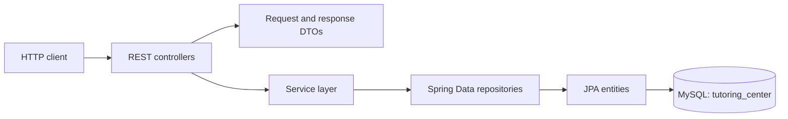
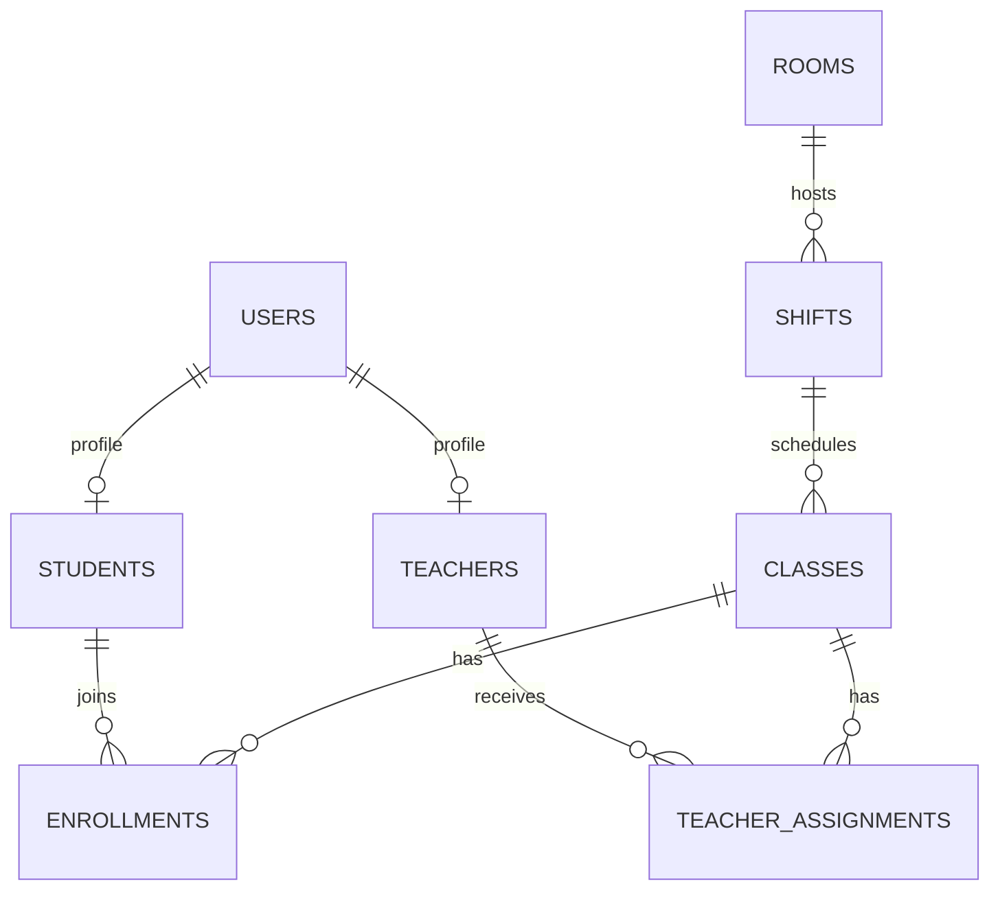

# Tutoring Center API

A Java backend for managing tutoring-center operations, including users, students, teachers, classrooms, weekly shifts, class enrollment, and teacher assignments. The repository implements a REST API with Spring-style controllers and a MySQL-backed JPA data model.

## Table of Contents

- [Overview](#overview)
- [Features](#features)
- [Technology Stack](#technology-stack)
- [Architecture](#architecture)
- [Project Structure](#project-structure)
- [Data Model](#data-model)
- [Getting Started](#getting-started)
- [Configuration](#configuration)
- [Running and Building](#running-and-building)
- [API Reference](#api-reference)
- [Usage Guide](#usage-guide)
- [Testing](#testing)
- [Deployment](#deployment)
- [Contributing](#contributing)
- [License and Contact](#license-and-contact)

## Overview

Tutoring Center is a backend service for organizing tutoring classes and their participants. Its implemented API supports maintaining user and profile records, scheduling classes into rooms and shifts, enrolling students, and assigning teachers.

The repository contains a REST API and persistence layer; it does not contain a frontend application. Intended users can be inferred from the API concepts (administrators, students, and teachers), but authentication and authorization enforcement are not verifiable from the supplied source tree.

## Features

- Create, read, update, and delete user accounts.
- Maintain student and teacher profiles associated with user records.
- Search students by name, phone number, or linked account email.
- Manage rooms and weekly shifts, including optional room assignment for a shift.
- Create and manage classes, and filter classes by room address or day of week.
- Enroll a student in a class and prevent duplicate enrollments.
- Assign teachers to classes and prevent duplicate assignments.
- Retrieve a student's schedules.
- Use soft-delete flags for student, teacher, and class records in the implemented service flows.

## Technology Stack

| Area | Verified implementation |
| --- | --- |
| Language | Java |
| Application framework | Spring Boot annotations and `SpringApplication` entry point are used. The exact Spring Boot version is not specified in the repository. |
| Web API | Spring Web MVC REST controllers |
| Persistence | Jakarta Persistence (JPA) with Hibernate annotations and Spring Data repository interfaces |
| Database | MySQL, configured at `localhost:3306/tutoring_center` by default |
| Validation | Jakarta Bean Validation annotations on request DTOs |
| JSON | Jackson time-format annotation is used for shift times |
| API examples | Root-level `.http` request files, suitable for a compatible HTTP client |
| Build and test tooling | Not specified: no Maven/Gradle build descriptor, wrapper, or automated test source tree is present. |

No frontend, authentication library, or third-party service integration is established by the tracked source files inspected.

## Architecture

The application follows a layered REST design:

1. Controllers expose `/api/v1` routes and bind HTTP requests to DTOs.
2. Service interfaces and implementations contain operations and business checks.
3. Spring Data repository interfaces provide persistence access.
4. JPA entities map to relational tables in MySQL.



The source includes a global exception handler and custom duplicate/state exceptions. No security configuration is present in the inspected repository tree. Route labels such as `/admin`, `/public`, and `/me` should therefore not be treated as proof of access control.

## Project Structure

```text
.
├── class-test.http
├── enrollment-test.http
├── room-test.http
├── shift-test.http
├── student-test.http
├── teacher-test.http
├── teacherassignment-test.http
├── user-test.http
└── src
    └── main
        ├── java/com/example/tutoring_center
        │   ├── TutoringCenterApplication.java
        │   ├── DateUtils.java
        │   ├── controller/       # REST endpoint definitions
        │   ├── custom_exception/ # Domain-specific duplicate/state exceptions
        │   ├── dto/              # API request and response records/classes
        │   ├── entity/           # JPA entities
        │   ├── exception/        # Global exception handling
        │   ├── repository/       # Persistence repository interfaces
        │   └── service/          # Service interfaces and implementations
        └── resources
            └── application.properties
```

There is no checked-in build descriptor or conventional `src/test` directory in the repository tree. The `.http` files contain manual API request examples rather than an automated test suite.

## Data Model

The JPA entities map to the following tables: `users`, `students`, `teachers`, `rooms`, `shifts`, `classes`, `enrollments`, and `teacher_assignments`. Hibernate is configured to update the schema automatically at startup (`spring.jpa.hibernate.ddl-auto=update`). Exact database column types and generated schema depend on Hibernate and the database version.

Key relationships declared in the entities:

- A student has a one-to-one link to a user; a teacher also has a one-to-one link to a user. Each profile's `user_id` is unique and non-null.
- A shift may reference one room; a room can be referenced by multiple shifts.
- A class references one shift; multiple classes may reference a shift at the entity mapping level.
- Enrollments link students to classes. The `student_id` and `class_id` pair is unique.
- Teacher assignments link teachers to classes. The `teacher_id` and `class_id` pair is unique.



The ERD represents entity associations, not an assertion that all associated foreign-key columns are mandatory. In particular, some relationships are mapped without `nullable = false`.

## Getting Started

### Prerequisites

- A MySQL server reachable from the application.
- A Java runtime and a Spring Boot-compatible build setup. The required Java version and build tool version are not specified in the repository.
- A build descriptor and dependency configuration are needed to compile/run this source, but neither is included in the repository tree.

### Database

The default configuration expects a database named `tutoring_center` on the local MySQL server. Create it before startup, for example:

```sql
CREATE DATABASE tutoring_center;
```

The configured MySQL account must have permission to access this database and create/update tables. Hibernate schema updates are enabled by default.

### Clone

```bash
git clone https://github.com/dangtrungghieu/tutoring-center.git
cd tutoring-center
```

The repository currently does not include Maven/Gradle metadata or a wrapper, so a reproducible dependency installation or build command cannot be provided from the checked-in files alone.

## Configuration

`src/main/resources/application.properties` contains these settings:

| Property | Current value | Purpose |
| --- | --- | --- |
| `spring.application.name` | `tutoring-center` | Application name |
| `spring.datasource.url` | `jdbc:mysql://localhost:3306/tutoring_center` | MySQL JDBC connection URL |
| `spring.datasource.username` | `root` | Database username |
| `spring.datasource.password` | empty | Database password in the checked-in default configuration |
| `spring.jpa.hibernate.ddl-auto` | `update` | Allows Hibernate to update the schema on startup |
| `spring.jpa.show-sql` | `true` | Logs generated SQL |
| `spring.jpa.properties.hibernate.format_sql` | `true` | Formats SQL output |

No application-specific environment variables are declared in the tracked configuration. The datasource values should be changed for the target environment; do not use an empty password or the sample local credentials in production. Spring Boot configuration overrides may be supplied by an external runtime/build setup, but such deployment configuration is not included here.

## Running and Building

The application entry point is `com.example.tutoring_center.TutoringCenterApplication`. However, this repository does not include a `pom.xml`, `build.gradle`, Maven/Gradle wrapper, or other build configuration, so there is no verified command to resolve dependencies, compile, or launch it. Add or provide the intended build setup before attempting to run the application.

Once launched through a suitable external Spring Boot build/runtime configuration, the `.http` examples target `http://localhost:8080`.

A production build/run procedure is not specified by the repository.

## API Reference

All routes below are declared by the controllers under `/api/v1`. Unless noted, request bodies are JSON DTOs and responses are JSON. Response fields are defined by the DTO classes; exact full response examples are omitted because they vary with stored records. Controller declarations set `201 Created` for the create operations identified below, `200 OK` for successful reads/updates, and `204 No Content` for delete operations returning no body.

The repository has no OpenAPI specification. The `/admin`, `/public`, and `/me` path segments describe route variants but no authentication requirement or enforcement can be confirmed from the inspected source.

### Users — `/api/v1/users`

| Method | Path | Purpose | Body / parameters |
| --- | --- | --- | --- |
| `POST` | `/api/v1/users` | Create a user (`201`) | `UserRequest`: email, password, role |
| `GET` | `/api/v1/users` | List users | None |
| `GET` | `/api/v1/users/{id}` | Get a user by ID | Path: `id` |
| `PUT` | `/api/v1/users/{id}` | Update a user's password and role | Path: `id`; `UserRequestUpdate` |
| `DELETE` | `/api/v1/users/{id}` | Delete a user | Path: `id`; returns `204` |

### Students — `/api/v1/students`

| Method | Path | Purpose | Body / parameters |
| --- | --- | --- | --- |
| `POST` | `/api/v1/students` | Create a student profile (`201`) | `StudentRequest`: linked `userId`, `fullName`, `phone` |
| `GET` | `/api/v1/students` | List students or search | Optional query parameter: `name`, `phone`, or `email` (if several are supplied, controller checks them in that order) |
| `PATCH` | `/api/v1/students/me/{id}` | Update a student's name and phone | Path: `id`; `StudentRequestUpdate` |
| `PUT` | `/api/v1/students/admin/{id}` | Update a student profile and linked user | Path: `id`; `StudentRequest` |
| `DELETE` | `/api/v1/students/admin/{id}` | Soft-delete a student and change linked user role | Path: `id`; returns `204` |
| `GET` | `/api/v1/students/{studentId}/schedules` | Get a student's schedules for non-deleted classes | Path: `studentId` |

### Teachers — `/api/v1/teachers`

| Method | Path | Purpose | Body / parameters |
| --- | --- | --- | --- |
| `POST` | `/api/v1/teachers` | Create a teacher profile (`201`) | `TeacherRequest`: linked `userId`, `fullName`, `phone` |
| `GET` | `/api/v1/teachers/public` | List non-deleted teachers | None |
| `GET` | `/api/v1/teachers/admin` | List all teachers | None |
| `GET` | `/api/v1/teachers/public/{id}` | Get a non-deleted teacher | Path: `id` |
| `GET` | `/api/v1/teachers/admin/{id}` | Get a teacher by ID | Path: `id` |
| `PUT` | `/api/v1/teachers/admin/{id}` | Update teacher profile and linked user | Path: `id`; `TeacherRequest` |
| `PUT` | `/api/v1/teachers/me/{id}` | Update teacher name and phone | Path: `id`; `TeacherRequestUpdate` |
| `DELETE` | `/api/v1/teachers/admin/{id}` | Soft-delete a teacher and change linked user role | Path: `id`; returns `204` |

### Classes, enrollments, and teacher assignments — `/api/v1/classes`

| Method | Path | Purpose | Body / parameters |
| --- | --- | --- | --- |
| `POST` | `/api/v1/classes` | Create a class (`201`) | `ClassRequest`: `subject`, `grade` (1–12), `shiftId` |
| `GET` | `/api/v1/classes/admin` | List all classes | None |
| `GET` | `/api/v1/classes/student` | List non-deleted classes | None |
| `GET` | `/api/v1/classes/{id}` | Get a class by ID | Path: `id` |
| `GET` | `/api/v1/classes` | Filter classes or return the admin list | Optional `roomAddress` or `shiftDayOfWeek`; room address takes precedence if both are supplied |
| `PUT` | `/api/v1/classes/admin/{id}` | Update a class | Path: `id`; `ClassRequest` |
| `DELETE` | `/api/v1/classes/admin/{id}` | Soft-delete a class | Path: `id`; returns `204` |
| `POST` | `/api/v1/classes/{classId}/students` | Enroll a student in a class | Path: `classId`; `EnrollmentRequest`: `studentId` |
| `POST` | `/api/v1/classes/{classId}/teachers` | Assign a teacher to a class | Path: `classId`; `TeacherAssignmentRequest`: `teacherId` |

Enrollment and teacher-assignment creation return their corresponding response DTOs. The controller currently returns the default `200 OK` for these operations.

### Rooms — `/api/v1/rooms`

| Method | Path | Purpose | Body / parameters |
| --- | --- | --- | --- |
| `POST` | `/api/v1/rooms` | Create a room (`201`) | `RoomRequest`: non-blank `address`, `capacity` of at least 1 |
| `GET` | `/api/v1/rooms` | List rooms | None |
| `GET` | `/api/v1/rooms/{id}` | Get a room by ID | Path: `id` |
| `PUT` | `/api/v1/rooms/{id}` | Update a room | Path: `id`; `RoomRequest` |
| `DELETE` | `/api/v1/rooms/{id}` | Delete a room | Path: `id`; returns `204` |

### Shifts — `/api/v1/shifts`

| Method | Path | Purpose | Body / parameters |
| --- | --- | --- | --- |
| `POST` | `/api/v1/shifts` | Create a shift (`201`) | `ShiftRequest`: `startTime`, `endTime` (`HH:mm`), `dayOfWeek` (2–8, Monday–Sunday), optional `roomId` |
| `GET` | `/api/v1/shifts` | List shifts | None |
| `GET` | `/api/v1/shifts/{id}` | Get a shift by ID | Path: `id` |
| `PUT` | `/api/v1/shifts/{id}` | Update a shift | Path: `id`; `ShiftRequest` |
| `DELETE` | `/api/v1/shifts/{id}` | Delete a shift | Path: `id`; returns `204` |

### Example request

The following class-creation example matches the request format shown in `class-test.http`:

```http
POST /api/v1/classes
Content-Type: application/json

{
  "subject": "Algebra",
  "grade": 11,
  "shiftId": 2
}
```

## Usage Guide

The `.http` files at the repository root provide request examples for each API area. With the application and MySQL database running, use a compatible editor HTTP client or import the requests into an HTTP tool. Common setup order based on entity dependencies is:

1. Create a user account for each student or teacher profile.
2. Create rooms and shifts (a shift may omit `roomId`).
3. Create classes using an existing `shiftId`.
4. Create student and teacher profiles using their `userId` values.
5. Enroll students and assign teachers through the class-specific routes.
6. Query the student's schedule using `/api/v1/students/{studentId}/schedules`.

These steps describe the entity dependencies and routes; the repository does not include a UI or a complete end-user workflow.

## Testing

No automated test framework or test source files are present in the repository. Root-level `.http` files provide manual request examples for users, students, teachers, rooms, shifts, classes, enrollments, and teacher assignments. Run them against a locally running API after preparing the database and application runtime.

## Deployment

Deployment configuration, container files, CI workflows, and production profiles are not present in the repository tree. Configure the MySQL connection and credentials securely for the target environment and provide a build/runtime setup before deployment. Review the current `ddl-auto=update` and SQL logging settings before using a production database.

## Contributing

No project-specific contribution guide is included. For changes, use a focused branch, keep API and persistence changes consistent, and include or update relevant HTTP request examples. Open a pull request describing the change and how it was verified.

## License and Contact

- **License:** Not specified in the repository metadata or tracked files inspected.
- **Contact:** Not specified.
